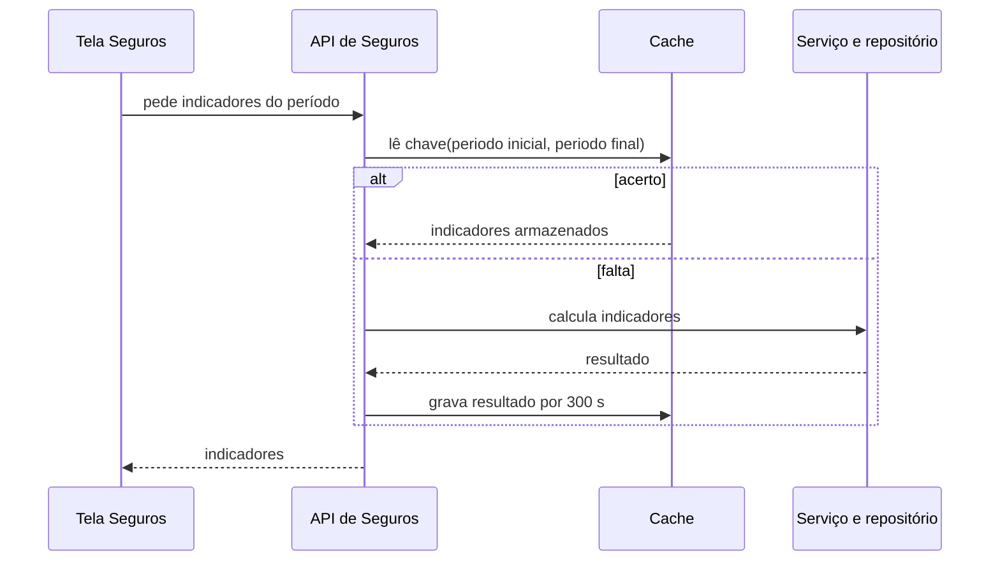
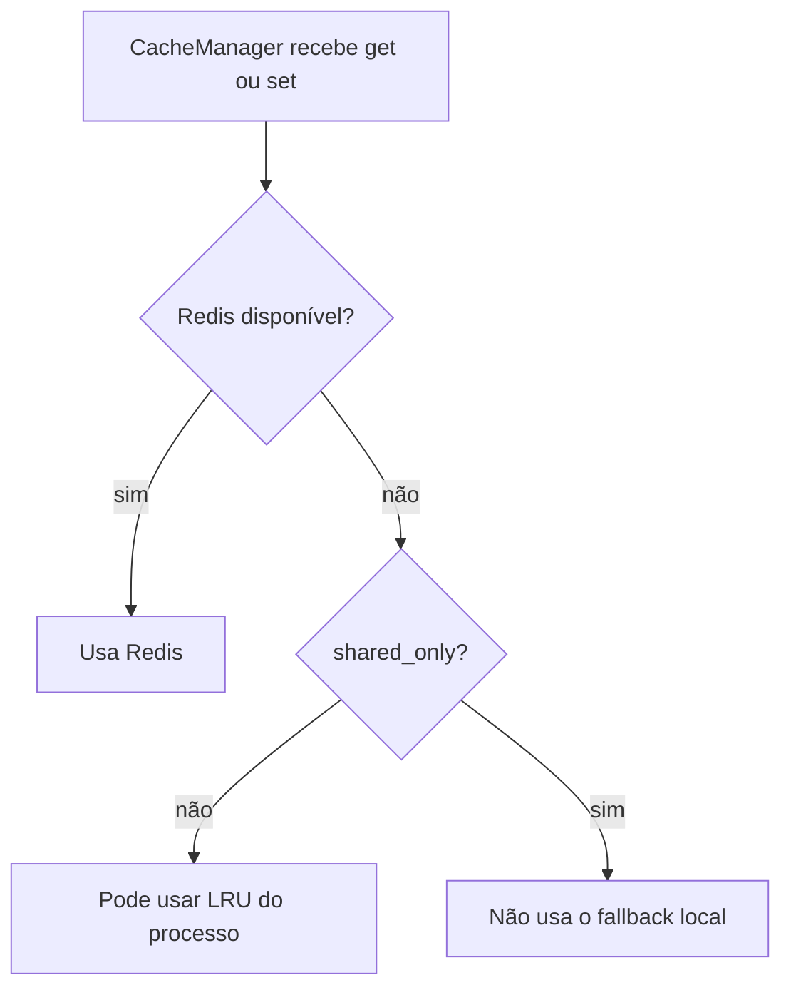
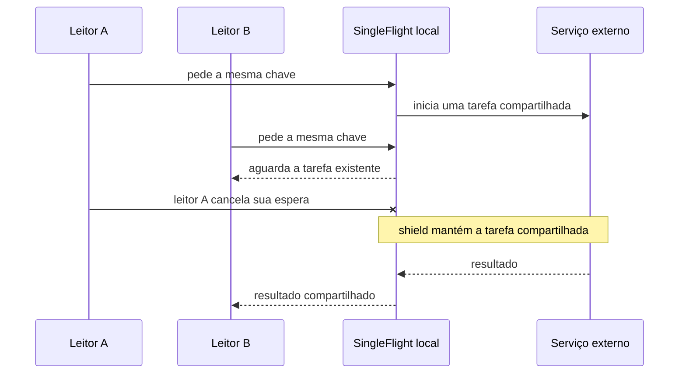
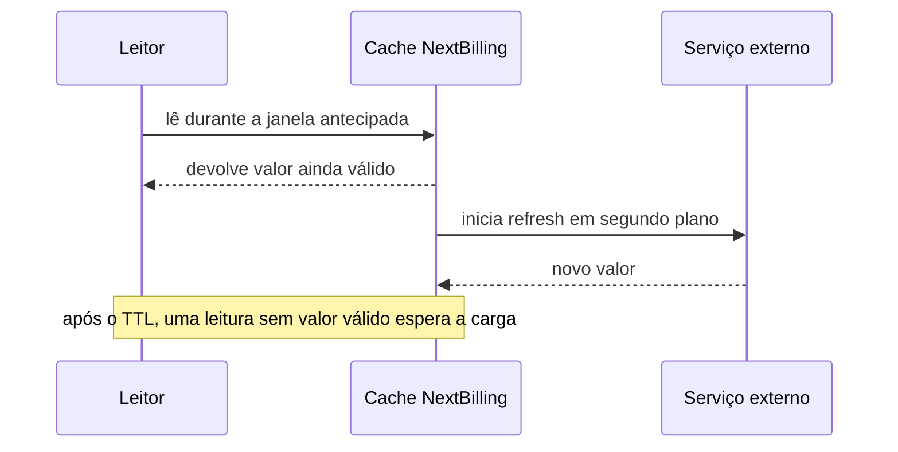

# L5A — cache, coordenação local e refresh

## Escopo e fonte da evidência

O checkout deste material foi conferido em 14/10/2026 às 17:37 UTC: `pwd -P` e raiz Git apontaram para `/Users/augustocarollo/.superset.noindex/worktrees/architecture-engineer-expert/perfect-citizen-a30f5998`, branch `perfect-citizen-a30f5998`, SHA `23d5d158d3a964dceba296296368ec14bcd8970b`. Os quatro casos MakersHub reutilizam os caminhos da [S2](./s2-application.md#L29) e o mapa de cache/histórico da [S5](./s5-operations.md#L19), cuja leitura local foi vinculada ao checkout `main` SHA `e233fb046ec333982cd1547171b0f0bd8d8d92ee` em 14/10 às 16:16 UTC. Isso prova código e diffs naquele checkout; não prova configuração ou comportamento em produção.

## 1. Indicadores de Seguros: cache-aside com TTL de 300 segundos

**Caso.** O gestor abre os indicadores por período. A tela envia os limites ao endpoint de Seguros.

**Dor.** Sem um acerto de cache, o caminho volta ao serviço e à consulta do repositório. A S2 não mediu quantas vezes isso ocorre nem o tempo economizado.

**Mecanismo.** A rota monta a chave com os dois limites, lê o cache, consulta serviço e repositório em uma falta e grava o resultado com TTL de 300 segundos. A fonte é `backend/app/api/v1/insurance.py:53–67` na S5; a S2 liga a tela, o DataManager, o endpoint e a consulta (`insurance_repo.py:74–99`).

**Limite.** Os cinco minutos limitam a validade da entrada; não garantem leitura nova da origem a cada pedido. A chave precisa representar o escopo pertinente. A S5 não confirmou que toda alteração de apólice invalida esse indicador.

## 2. Redis indisponível: fallback local com exceção `shared_only`

**Caso.** O `CacheManager` escolhe Redis quando disponível e memória local quando Redis não está disponível.

**Dor.** Chamar isso de “L1 local sempre consultada antes da L2 Redis” descreve uma hierarquia que o código não implementa.

**Mecanismo.** `cache_manager.py:128` verifica disponibilidade antes de selecionar o backend. O fallback usa LRU local com expiração monotônica (`:50`). Para operações marcadas `shared_only=True`, como os usos de autorização apontados pela S5 (`:139`, `:193`), o código não lê nem grava o fallback local.

**Limite.** Memória local pertence ao processo e não é cópia compartilhada entre workers. `shared_only` restringe esse caminho; não prova o que a rota responderá nem converte a memória em cache distribuído. A S5 aponta invalidação local e tentativa em Redis (`:221`, `:249`), sem alegar atomicidade.

## 3. Uma leitura cancelada não cancela a tarefa compartilhada

**Caso.** O operador consulta a lista de ligações online; o caminho NextBilling passa por `SingleFlightCache` (`nextbilling_integration.py:198–218`, S5).

**Dor.** Vários leitores simultâneos da mesma chave podem repetir o mesmo pedido ao serviço externo.

**Mecanismo.** O diff histórico `a304a4e56480648bdc60be96c00532c38d18df9f` (`FBI-2331`, 03/06/2026) troca a espera direta por `asyncio.shield` e deixa a limpeza no callback da tarefa compartilhada. Assim, cancelar um leitor não propaga automaticamente o cancelamento para a tarefa que os demais aguardam. A semântica de `shield` está na [documentação oficial do asyncio](https://docs.python.org/3/library/asyncio-task.html#shielding-from-cancellation).

**Limite.** O objeto coordena leitores dentro de um processo; não é lock global. O diff é histórico e a S5 não verificou implantação; os testes adicionados no commit não foram executados naquela lane.

**Exemplo didático em dois processos, com a mesma chave K.** Suponha que K não tenha entrada válida na memória local de nenhum processo. Às 10h, o pedido 1 chega ao processo P1 e o pedido 2 chega ao processo P2. P1 não enxerga a tarefa local de P2; cada processo pode abrir uma chamada ao serviço externo. Leitores adicionais dentro de P1 podem juntar-se à tarefa de P1, e leitores dentro de P2 à de P2. Neste cenário, a coordenação local permite duas chamadas externas para K; ela não deduplica globalmente.

| Processo P1 | Processo P2 |
|---|---|
| pedido 1(K) → tarefa local 1 → chamada externa 1 | pedido 2(K) → tarefa local 2 → chamada externa 2 |

## 4. Refresh antecipado começa durante uma leitura

**Caso.** O feed online de NextBilling é lido durante a janela antecipada configurada.

**Dor.** Esperar a expiração total pode obrigar o próximo leitor a aguardar o novo pedido externo.

**Mecanismo.** O diff histórico `a8bb7023f1ad080cb899cccfb73225231b28e235` (`FBI-2331`, 03/06/2026) adiciona limiar, renovação em segundo plano e configuração no consumidor. Uma leitura na janela dispara o refresh; o valor atual segue utilizável enquanto a renovação ocorre. A S5 registra que o arquivo declara TTL de 1 s e limiar de 0,5 s, mas não mediu valores efetivos do processo.

**Limite.** A renovação é acionada por leitura elegível, não por um job periódico de warming. Sem leitura durante a janela, a entrada pode expirar; depois da expiração, o leitor precisa aguardar a carga. O diff não prova disponibilidade após o TTL nem implantação.

## Comparação para estudo e aplicação OSS

Redis documenta cache-aside com TTL e leitura da origem em falta ([guia](https://redis.io/docs/latest/develop/use-cases/cache-aside/)). Caffeine documenta `refreshAfterWrite`: a chave só inicia refresh quando consultada e ainda pode expirar se ninguém a ler ([guia](https://github.com/ben-manes/caffeine/wiki/Refresh)). Cashews oferece cache assíncrono Python, backends em memória e Redis, TTL e opções de lock por chave ([projeto e implementação](https://github.com/Krukov/cashews)). São referências para comparar mecanismos, não uma recomendação de troca de stack.

O Apache Superset fornece dois pontos de implementação OSS para leitura: o [processador de query](https://github.com/apache/superset/blob/master/superset/common/query_context_processor.py#L2719-L2752) lê ou grava resultado com `set_query_result` e resolve o timeout; e o [utilitário de cache](https://github.com/apache/superset/blob/master/superset/utils/cache.py#L942-L1049) aplica o timeout ao `cache_instance.set`. Esses links apontavam para `master` em 14/10/2026 às 17:37 UTC e podem mudar; não comprovam qual backend ou configuração roda numa instalação particular.
