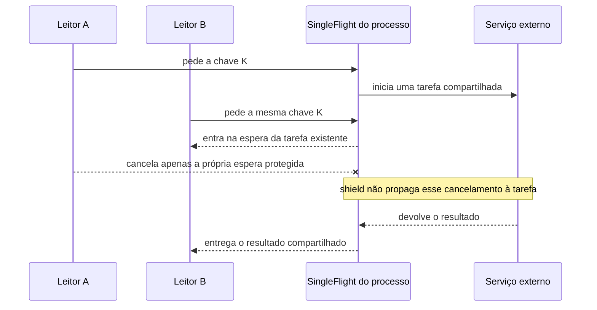
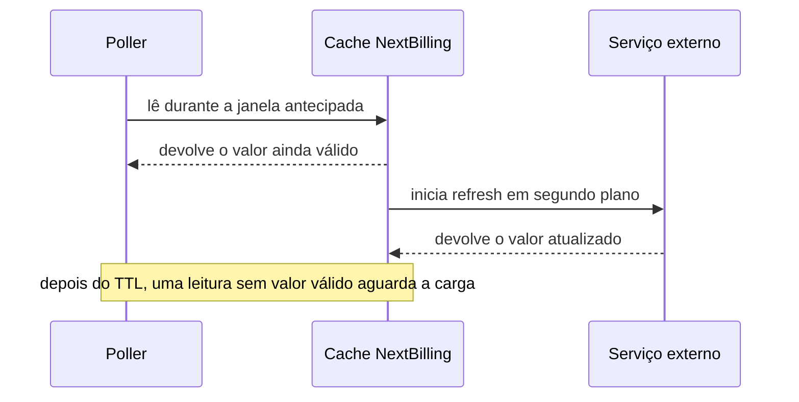
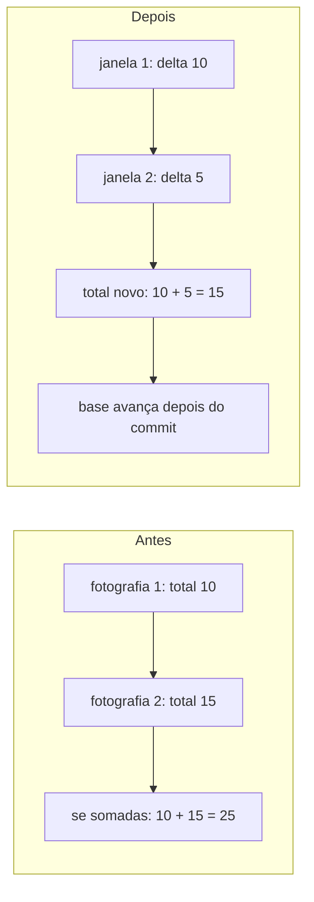

# L5B — retries, coordenação e pressão de entrada

## Escopo e evidência

Este registro reutiliza os diffs e caminhos citados em [S5](./s5-operations.md#L55-L61) e [S5 — código](./s5-operations.md#L29-L49), sem nova varredura histórica. Em 14/10/2026 às 16:16 UTC, S5 registrou os três SHAs como ancestrais de `main` local (`e233fb046ec333982cd1547171b0f0bd8d8d92ee`). Isso prova presença no histórico daquele checkout; não prova deploy, ocorrência em produção ou execução dos testes.

## Três mudanças históricas

### 1. Um leitor cancelado não interrompe a chamada compartilhada

No diff `a304a4e56480648bdc60be96c00532c38d18df9f` (`FBI-2331`, 03/06/2026), a espera passa a usar `asyncio.shield`, e limpeza/gravação passam do `finally` de cada leitor para a conclusão da tarefa compartilhada. Antes, cancelar um leitor podia cancelar o trabalho aguardado pelos demais. Depois, o cancelamento não se propaga automaticamente à tarefa protegida.

Imagine cinco leitores da mesma chave e o leitor A fechando a tela. A tarefa pode continuar para os outros quatro, evitando que percam a chamada compartilhada e iniciem trabalho duplicado. É exemplo hipotético, não ocorrência medida. O conceito é separar o ciclo de vida do leitor do trabalho compartilhado, que continua limitado ao processo que o criou.

### 2. Refresh antecipado começa quando alguém lê

No diff `a8bb7023f1ad080cb899cccfb73225231b28e235` (`FBI-2331`, 03/06/2026), o cache NextBilling ganha limiar de refresh, atualização em segundo plano e configuração no consumidor. Antes, uma leitura depois da expiração aguardava nova carga. Depois, uma leitura na janela inicia o refresh e pode receber o valor ainda válido.

Isso pode evitar espera, ao custo de chamadas upstream e de aceitar um valor mais antigo. Não é job periódico: depende de leitura na janela e não garante valor depois do TTL. O arquivo declara TTL de 1 s e limiar de 0,5 s, não medidos no processo.

### 3. Métricas passam de acumulados a deltas

No diff `84ef5d40ee205fd9ce420c646b2492c715c45ea6` (`FBI-2563`, 29/06/2026), métricas passam de acumulados para deltas e a base só avança após o commit. No exemplo da S5, totais 10 e 15 somados dariam 25, contando os primeiros 10 duas vezes. Deltas de 10 e 5 somam 15. Se a gravação não for confirmada, a base não avança.

O commit relata overflow; não afirmo causa atual no banco nem reprodução do relato. O conceito é distinguir total acumulado de movimento novo e alinhar o avanço da base à confirmação da gravação.

## Quatro mecanismos no código do checkout

O recorte abaixo é a leitura de código de `main` SHA `e233fb046ec333982cd1547171b0f0bd8d8d92ee` registrada pela S5 em 14/10/2026 às 16:16 UTC. São propriedades dos arquivos daquele checkout, não configuração efetiva de produção.

| Caminho | Mecanismo no checkout | Dor e limite |
|---|---|---|
| `backend/app/integrations/airflow_client.py:53,279,383` | HTTPX compartilhado, limites e timeouts por fase, até três tentativas; 502/503/504 usam backoff exponencial e jitter de até 30% da base. | Uma falha transitória pode ser repetida. Timeouts por fase não são um prazo total propagado; três tentativas são código lido, não medida de produção. |
| `backend/app/core/task_queue.py:127`; `backend/app/core/task_worker.py:227,314` | Worker consulta breaker `closed/open/half-open` e repete com backoff sem jitter. | O breaker pode recusar enquanto aberto e o backoff espaça execuções. Não está provado que essas tentativas e as HTTPX se aninhem em produção. Envoy limita recursos por cluster; Resilience4j documenta estados de falha. Não são equivalentes automaticamente. |
| `backend/app/core/task_worker.py:47,166,181`; `backend/app/core/task_queue.py:324–371` | Semáforo local declara quatro vagas; worker retira com `BLPOP`; produtor usa `RPUSH` sem gate de tamanho nesse caminho. | Execução local limitada não isola memória nem liga admissão à capacidade. Pode haver espera na fila; isso não prova tamanho, capacidade do Redis ou fila infinita. Execução limitada não é backpressure total. |
| `backend/app/core/rate_limiter.py:122,191`; `backend/app/api/v1/auth.py:79,173` | SlowAPI usa Redis e janela fixa nas rotas de autenticação citadas. | Limite de frequência não é autenticação nem concorrência do worker. `swallow_errors=True` está declarado; o comportamento do serviço não foi medido. |

Se duas camadas envolverem a mesma operação e cada uma permitir três execuções, o teto teórico será `3 × 3 = 9` chamadas externas. É hipótese, não configuração medida nem prova de encadeamento. A quantidade real depende das políticas efetivas.

## Referências OSS para comparação

| Mecanismo | Base e app OSS para comparação |
|---|---|
| Breaker por estados | [Resilience4j](https://resilience4j.readme.io/docs/circuitbreaker) explica a máquina de estados; o [demo de microserviços](https://github.com/SpringMicroservicesCourse/resilience4j-circuitbreaker-demo#annotation-based-circuit-breaker-order-endpoint) mostra `@CircuitBreaker` numa rota. |
| Breaker de recursos | [Envoy](https://www.envoyproxy.io/docs/envoy/latest/intro/arch_overview/upstream/circuit_breaking) documenta limites por cluster; o [guia Envoy Gateway](https://gateway.envoyproxy.io/latest/tasks/traffic/circuit-breaker/) mostra a política ligada à rota. Não é automaticamente um breaker por taxa de falha e estados. |
| Timeout e retry HTTP | [HTTPX timeouts](https://www.python-httpx.org/advanced/timeouts/) separa connect/read/write/pool; [transports](https://www.python-httpx.org/advanced/transports/) limita retries embutidos a falhas de conexão. O [cliente LangChain](https://github.com/langchain-ai/langchain/blob/master/libs/partners/openai/langchain_openai/chat_models/base.py#L3645-L3655) é um exemplo de integração HTTPX. |
| Limite de taxa | [`limits`](https://limits.readthedocs.io/en/stable/strategies.html) compara estratégias; [SlowAPI](https://github.com/laurentS/slowapi/blob/master/docs/index.md#fastapi) mostra a integração FastAPI. A [rota Apache APISIX](https://github.com/apache/apisix/blob/master/docs/en/latest/plugins/limit-count.md#apply-rate-limiting-by-remote-address) exemplifica quota por IP e 429 em um gateway. |
