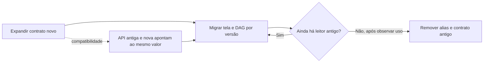
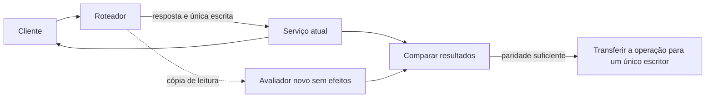
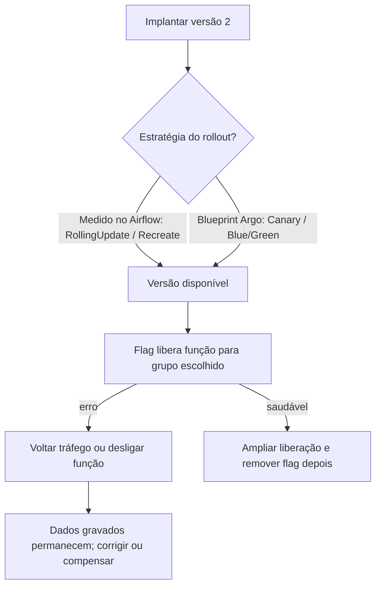
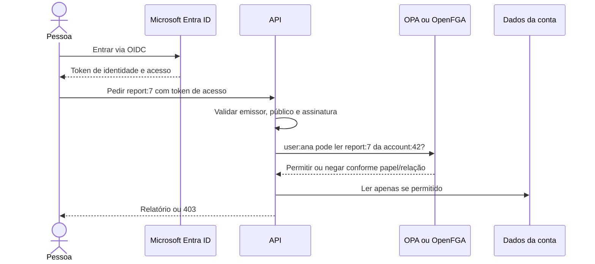

# S6C — quatro histórias de mudança segura e autorização

As quatro histórias de `safe-change` e `security` são propostas didáticas. `employee` e `account` são fictícios; nenhuma história descreve implementação existente.

## 1. Renomear um campo sem parar API, tela e DAG

Uma mudança de contrato não precisa obrigar três equipes a publicar no mesmo minuto. No exemplo fictício, `employee.name` passa a `display_name` para API, tela e DAG de leitura. Na expansão, a API aceita e devolve ambas as chaves como aliases do mesmo valor. Frontend e DAG passam a preferir o novo campo, mas ainda aceitam o antigo. Só depois que as versões antigas deixam de ler o contrato, removemos o alias e renomeamos a coluna física.

O ganho é publicar cada consumidor por vez; o custo é manter e depois remover o alias. Se a equipe esquece a contração, dois nomes ficam para sempre. Gravar duas colunas independentes pode deixá-las divergentes, por isso o exemplo mantém uma fonte de verdade. Martin Fowler descreve essas fases para API e banco em [Parallel Change](https://martinfowler.com/bliki/ParallelChange.html), também chamado Expand/Contract.

## 2. Strangler e Shadow Traffic: comparar leitura sem duplicar efeitos

Uma empresa pode trocar uma função por vez. No exemplo fictício, um roteador mantém a consulta no serviço atual e copia os dados necessários para um avaliador novo, que calcula sem gravar, notificar ou chamar outros sistemas. A pessoa continua recebendo a resposta antiga até a equipe aprovar a comparação; na troca de escrita, uma única versão assume cada operação.

Essa cópia só de leitura é Shadow Traffic dentro de uma migração Strangler Fig. O ganho é descobrir diferenças antes da troca; o custo é CPU extra e proteção dos dados copiados. No código do MakersHub lido pelo [S2](s2-application.md), `POST /api/v1/super-r1/qualify` chama `run_qualify` e persiste uma intenção de roteamento. Reexecutar essa escrita como sombra poderia repetir efeitos. A comparação é proposta, não execução observada; [Fowler descreve a migração gradual](https://martinfowler.com/bliki/StranglerFigApplication.html).

## 3. Separar implantação, liberação e retorno do código

Implantar é colocar uma versão no ambiente; liberar é permitir que pessoas usem a função. Argo Rollouts troca tráfego entre versões por Canary ou Blue/Green. Uma flag Unleash habilita comportamento dentro do código implantado; ela controla exposição, não autorização. São controles diferentes e podem ser combinados.

Na captura S6 do namespace `airflow`, em 14/10/2026 às 16:11 UTC, a API tinha duas réplicas com `RollingUpdate` e o scheduler uma com `Recreate`; não foram medidos Canary, Blue/Green ou Unleash. São blueprints. No exemplo fictício, a versão 2 é implantada para todos, mas uma flag libera o resumo novo para 10 de 100 contas sintéticas; uma Canary, separadamente, direciona parte das requisições à versão 2. O ganho é observar sinais com exposição menor; o custo é manter versões, métricas e flags temporariamente. Desligar a flag ou voltar o tráfego não apaga gravações no banco: é preciso manter compatibilidade ou corrigir/compensar dados.

As fontes primárias são [Canary e Blue/Green do Argo Rollouts](https://argo-rollouts.readthedocs.io/en/stable/features/canary/), o [demo oficial](https://github.com/argoproj/rollouts-demo) e as [estratégias de ativação do Unleash](https://docs.getunleash.io/concepts/activation-strategies). O demo contém ambas as estratégias; isso não prova instalação no ambiente medido. O snapshot `github-snapshot.json` registrou `rollouts-demo` HTTP 200 às 17:12:53Z e `argo-rollouts` HTTP 200 às 17:12:54Z; são recibos da consulta, não de uso local.

## 4. Identidade não decide sozinha a conta autorizada

No exemplo fictício, uma pessoa entra por Microsoft Entra ID. OAuth 2.0 permite acesso delegado à API; OIDC acrescenta identidade e token de ID. A API valida seu token de acesso e verifica se a pessoa pode ler aquele relatório naquela conta. O login identifica a pessoa; a regra decide o que ela pode ler.

Com RBAC, a equipe atribui `viewer` ou `admin` à pessoa dentro da conta; isso é simples com papéis estáveis. Com ReBAC, a regra segue relações: `user:ana` é `viewer` da `account:42`, e `report:7` pertence a ela. Ana pode abrir o relatório da conta 42; uma tentativa na conta 43 recebe 403. O ganho é impedir acesso fora da conta; o custo é atualizar as relações quando os membros mudam. O [sample-stores do OpenFGA](https://github.com/openfga/sample-stores) inclui um exemplo de RBAC multi-tenant. O tutorial HTTP do [OPA](https://www.openpolicyagent.org/docs/http-api-authorization) consulta uma aplicação REST de demonstração e retorna `allow` ou `deny`. [Keycloak Quickstarts](https://github.com/keycloak/keycloak-quickstarts) oferece aplicações-exemplo para integração OIDC; Keycloak é alternativa OSS de provedor, não implantação medida aqui.

A medição S6 apontou Airflow FAB como auth manager às 16:15 UTC de 14/10/2026; OAuth/OIDC não foram confirmados nesse ambiente. O exemplo Azure e as decisões RBAC/ReBAC são propostas. Fontes verificadas: [Microsoft Entra OIDC](https://learn.microsoft.com/en-us/entra/architecture/auth-oidc) e [OpenFGA para SaaS multi-tenant](https://openfga.dev/docs/use-cases/multi-tenant-saas).

## Escopo e recibos

O S2 mediu código no checkout local MakersHub `e233fb046ec333982cd1547171b0f0bd8d8d92ee`; isso não é prova de deploy. O S6 mediu apenas os recursos do namespace `airflow`: `NetworkPolicies=[]` não prova isolamento de rede geral, e `Ingress.spec.tls=None` não exclui terminação TLS em salto anterior. Esta frente não auditou outra infraestrutura. As fontes online foram abertas entre 18:09 e 18:12 UTC de 14/10/2026.

- [2026-10-14 18:14:33 UTC] worktree do curso — `pwd -P; git branch --show-current; git rev-parse HEAD` → `/Users/augustocarollo/.superset.noindex/worktrees/architecture-engineer-expert/perfect-citizen-a30f5998`, `perfect-citizen-a30f5998`, `23d5d158d3a964dceba296296368ec14bcd8970b`.
- [2026-10-14 16:11 UTC] captura S6, Deployment no namespace `airflow` — `kubectl get deployments -o json` → scheduler `strategy.type=Recreate`; API, dag-processor, triggerer e PgBouncer DW `RollingUpdate, maxSurge=0, maxUnavailable=1`.
- [2026-10-14 16:10–16:14 UTC] captura S6, segurança no namespace `airflow` — `kubectl get rolebindings -o json; kubectl get ingresses -o json; GET networkpolicies` → RoleBindings `airflow-pg`, `airflow-pod-log-reader-rolebinding`, `cnpg-certificados-le-clusters`, `deploy-agent`; ingress `tls=None`; NetworkPolicies `[]`.
- [2026-10-14 16:15 UTC] captura S6, scheduler Airflow — `conf.get("core","auth_manager")` → `airflow.providers.fab.auth_manager.fab_auth_manager.FabAuthManager`.
